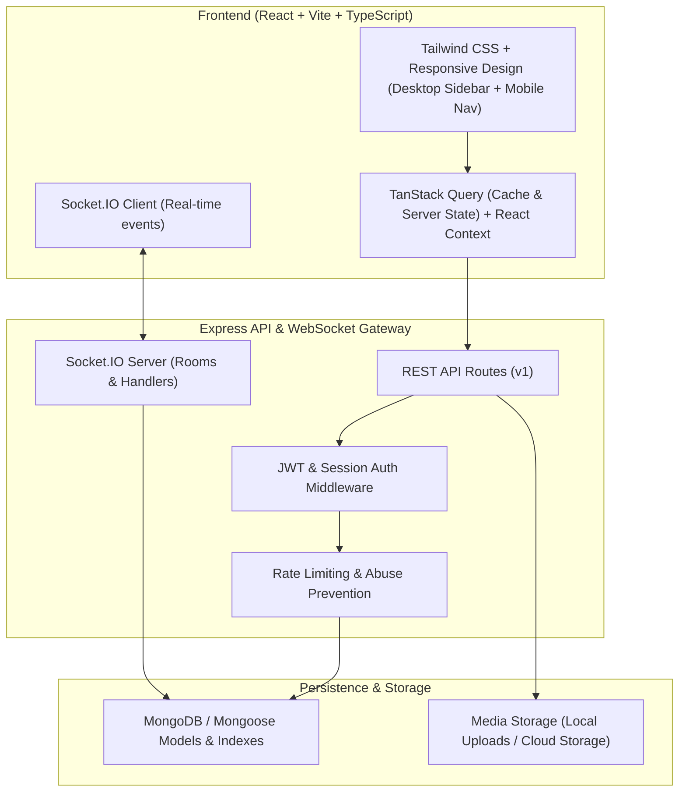

# SocialSphere Architecture Specification & Design Document

**System**: SocialSphere - Modern Scalable Social Media Platform  
**Version**: 1.0.0  
**Status**: Production Architecture  
**Author**: Antigravity Full-Stack & Security Architecture Team  

---

## 1. High-Level Architecture Overview

SocialSphere is structured as a decoupled, full-stack progressive web platform with real-time bidirectional capabilities:

---

## 2. Database Schema Design (Mongoose / MongoDB)

### 2.1 Collections & Indexing Strategies

1. **`User`**:
   - `username`: String (Unique, Indexed, lowercase, alphanumeric + underscores).
   - `email`: String (Unique, Indexed, lowercase).
   - `passwordHash`: String (Argon2 / bcrypt, never selected by default).
   - `displayName`: String.
   - `avatar`: String (URL).
   - `coverPhoto`: String (URL).
   - `bio`: String (Max 250 chars).
   - `website`: String.
   - `isPrivate`: Boolean (Default: false).
   - `isVerified`: Boolean (Default: false).
   - `role`: Enum (`'user'`, `'moderator'`, `'admin'`).
   - `status`: Enum (`'active'`, `'suspended'`, `'banned'`).
   - `followersCount`: Number (Indexed for ranking).
   - `followingCount`: Number.
   - `postsCount`: Number.
   - `blockedUsers`: Array of `ObjectId` refs (`User`).
   - `mutedUsers`: Array of `ObjectId` refs (`User`).
   - `createdAt`, `updatedAt`: Timestamps.

2. **`RefreshToken`**:
   - `userId`: `ObjectId` ref (`User`), Indexed.
   - `token`: String, Indexed.
   - `expiresAt`: Date (TTL Index for auto-cleanup).
   - `revoked`: Boolean.

3. **`Post`**:
   - `author`: `ObjectId` ref (`User`), Indexed.
   - `content`: String (Max 2000 chars).
   - `media`: Array of `{ url: String, type: 'image' | 'video', thumbnail?: String }`.
   - `hashtags`: Array of Strings, Indexed.
   - `mentions`: Array of Strings.
   - `likesCount`: Number (Default: 0, Indexed for trending).
   - `commentsCount`: Number (Default: 0).
   - `sharesCount`: Number (Default: 0).
   - `visibility`: Enum (`'public'`, `'followers'`, `'private'`).
   - `originalPost`: Optional `ObjectId` ref (`Post`) for reposts / quotes.
   - `isDeleted`: Boolean (Soft delete).
   - `createdAt`, `updatedAt`: Timestamps (Indexed: `{ createdAt: -1 }`).

4. **`Comment`**:
   - `post`: `ObjectId` ref (`Post`), Indexed.
   - `author`: `ObjectId` ref (`User`), Indexed.
   - `content`: String (Max 500 chars).
   - `parentComment`: Optional `ObjectId` ref (`Comment`) for threaded replies.
   - `likesCount`: Number (Default: 0).
   - `createdAt`, `updatedAt`: Timestamps.

5. **`Like`**:
   - `user`: `ObjectId` ref (`User`).
   - `target`: `ObjectId` (Post or Comment).
   - `targetType`: Enum (`'Post'`, `'Comment'`).
   - **Compound Index**: `{ user: 1, target: 1 }` (Unique).

6. **`Follow`**:
   - `follower`: `ObjectId` ref (`User`), Indexed.
   - `following`: `ObjectId` ref (`User`), Indexed.
   - `status`: Enum (`'accepted'`, `'pending'`).
   - **Compound Index**: `{ follower: 1, following: 1 }` (Unique).

7. **`Story`**:
   - `author`: `ObjectId` ref (`User`), Indexed.
   - `mediaUrl`: String.
   - `mediaType`: Enum (`'image'`, `'video'`).
   - `caption`: Optional String.
   - `viewers`: Array of `ObjectId` refs (`User`).
   - `expiresAt`: Date (TTL Index set to 24 hours after creation).
   - `createdAt`: Date.

8. **`Conversation`**:
   - `participants`: Array of `ObjectId` refs (`User`), Indexed.
   - `lastMessage`: Optional `ObjectId` ref (`Message`).
   - `updatedAt`: Date (Indexed: `{ updatedAt: -1 }`).

9. **`Message`**:
   - `conversation`: `ObjectId` ref (`Conversation`), Indexed.
   - `sender`: `ObjectId` ref (`User`), Indexed.
   - `content`: String (Encrypted / sanitized text).
   - `media`: Optional `{ url: String, type: 'image' | 'file' }`.
   - `readBy`: Array of `ObjectId` refs (`User`).
   - `createdAt`: Date (Indexed: `{ conversation: 1, createdAt: -1 }`).

10. **`Notification`**:
    - `recipient`: `ObjectId` ref (`User`), Indexed.
    - `sender`: `ObjectId` ref (`User`).
    - `type`: Enum (`'like'`, `'comment'`, `'follow'`, `'follow_request'`, `'mention'`, `'repost'`, `'system'`).
    - `post`: Optional `ObjectId` ref (`Post`).
    - `message`: Optional String.
    - `isRead`: Boolean (Default: false, Indexed: `{ recipient: 1, isRead: 1 }`).
    - `createdAt`: Date.

11. **`Bookmark`**:
    - `user`: `ObjectId` ref (`User`), Indexed.
    - `post`: `ObjectId` ref (`Post`), Indexed.
    - **Compound Index**: `{ user: 1, post: 1 }` (Unique).

12. **`Report` & `AuditLog`**:
    - `reporter`: `ObjectId` ref (`User`).
    - `targetId`: `ObjectId` (Post or User).
    - `targetType`: Enum (`'post'`, `'user'`).
    - `reason`: String.
    - `status`: Enum (`'pending'`, `'resolved'`, `'dismissed'`).
    - `resolvedBy`: Optional `ObjectId` ref (`User`).
    - `resolutionNotes`: String.

---

## 3. Real-Time Socket.IO Protocol Specification

| Channel / Event | Payload | Purpose |
|---|---|---|
| `connection` | Handshake with auth token | Authenticates socket and joins user-specific room (`user:<userId>`) |
| `join_conversation` | `{ conversationId: string }` | Joins chat room for live updates |
| `leave_conversation`| `{ conversationId: string }` | Leaves chat room |
| `send_message` | `{ conversationId, content, media? }` | Emits message to conversation room and recipient |
| `new_message` | `MessageObject` | Emitted to participants with sound / unread badge trigger |
| `typing_start` | `{ conversationId, userId }` | Broadcast to conversation room |
| `typing_stop` | `{ conversationId, userId }` | Broadcast to conversation room |
| `message_read` | `{ conversationId, messageId, readerId }` | Updates read receipt in real-time |
| `new_notification` | `NotificationObject` | Dispatched to `user:<recipientId>` room |
| `user_presence` | `{ userId, status: 'online' \| 'offline' }` | Broadcasts user availability |

---

## 4. REST API Endpoint Catalog

### Authentication (`/api/v1/auth`)
- `POST /register`: Register new user with username, email, password.
- `POST /login`: Authenticate and receive access token + refresh token.
- `POST /refresh`: Refresh expired access token with valid refresh token.
- `POST /logout`: Invalidate refresh token and clear cookies.
- `GET /me`: Fetch authenticated user profile.
- `POST /check-username`: Instant availability check for onboarding.
- `POST /forgot-password`: Request password reset token.
- `POST /reset-password`: Complete password reset with token.

### Posts & Feed (`/api/v1/posts`)
- `GET /feed`: Personalized feed (Tabs: `for-you`, `following`).
- `GET /explore`: Discovery feed sorted by engagement and recency.
- `POST /`: Create post with media, mentions, hashtags, visibility.
- `GET /:id`: Retrieve single post with comments.
- `PATCH /:id`: Edit post content.
- `DELETE /:id`: Soft delete own post (or admin moderation).
- `POST /:id/like`: Toggle like on post.
- `POST /:id/bookmark`: Toggle bookmark on post.
- `POST /:id/repost`: Repost / share post.

### Comments (`/api/v1/posts/:postId/comments`)
- `GET /`: List comments for post with threaded reply structure.
- `POST /`: Create comment or threaded reply.
- `DELETE /:commentId`: Delete comment (author or post owner).
- `POST /:commentId/like`: Toggle like on comment.

### User Profiles & Social Graph (`/api/v1/users`)
- `GET /:username`: Retrieve public profile and stats.
- `PATCH /profile`: Update profile info (displayName, bio, website, avatar, coverPhoto, isPrivate).
- `POST /:userId/follow`: Follow or request to follow user.
- `POST /:userId/unfollow`: Unfollow user.
- `GET /:userId/followers`: List user followers with pagination.
- `GET /:userId/following`: List accounts followed with pagination.
- `GET /:userId/posts`: List user posts.
- `GET /:userId/saved`: List authenticated user's saved posts.
- `POST /:userId/block`: Block user.
- `POST /:userId/unblock`: Unblock user.

### Direct Messaging (`/api/v1/messages`)
- `GET /conversations`: Retrieve active conversations with last message & unread badge.
- `POST /conversations`: Create or retrieve 1-on-1 conversation with user.
- `GET /conversations/:id/messages`: Paginated message history.
- `POST /conversations/:id/messages`: Send message (text/media).
- `POST /conversations/:id/read`: Mark conversation as read.

### Stories (`/api/v1/stories`)
- `GET /feed`: Grouped active stories from followed users + own story.
- `POST /`: Upload new story (image/video, caption).
- `POST /:id/view`: Record viewer for story.
- `DELETE /:id`: Delete active story.

### Search & Discovery (`/api/v1/search`)
- `GET /`: Global search query for users, posts, and hashtags.
- `GET /trending`: Top trending hashtags and active topics.
- `GET /suggested`: Smart account suggestions.

### Notifications (`/api/v1/notifications`)
- `GET /`: Retrieve user notifications.
- `PATCH /read-all`: Mark all notifications as read.
- `PATCH /:id/read`: Mark single notification as read.

### Media Uploads (`/api/v1/uploads`)
- `POST /`: Multipart form-data upload for images & short videos with validation.

### Admin & Moderation (`/api/v1/admin`)
- `GET /metrics`: Platform metrics (total users, posts, daily engagement, report queue size).
- `GET /users`: Paginated user list with role filters and suspension actions.
- `PATCH /users/:id/status`: Suspend, ban, or restore user account.
- `GET /reports`: Moderation queue of pending reports.
- `PATCH /reports/:id`: Resolve or dismiss report.
- `DELETE /posts/:id`: Force-remove inappropriate post.
- `GET /audit-logs`: Structured audit trail of admin and moderation actions.

---

## 5. Security & Privacy Hardening

1. **Password Security**: Argon2id / bcrypt hashing with 12 salt rounds, rejecting common or weak passwords.
2. **Token Security**: Short-lived JWTs (15 min) signed with distinct secret; refresh tokens stored hashed in DB with revocation support.
3. **Protection Middleware**:
   - `helmet` for secure HTTP response headers (HSTS, CSP, X-Frame-Options).
   - `cors` restricted to authorized frontend origins.
   - `express-rate-limit` to prevent brute force on `/api/v1/auth/*` and spamming on `/api/v1/posts`.
   - `mongo-sanitize` to neutralize NoSQL operator injection (`$gt`, `$ne`).
4. **Input Validation**: Strict schema parsing using `zod` on all request bodies, query params, and route params.
5. **Role-Based Access Control**: Server-side validation of user role (`admin` / `moderator`) with forbidden responses (`403`) for non-privileged callers.
